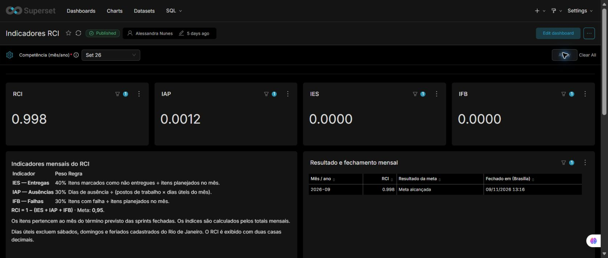
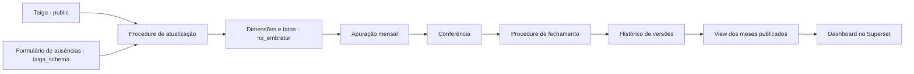
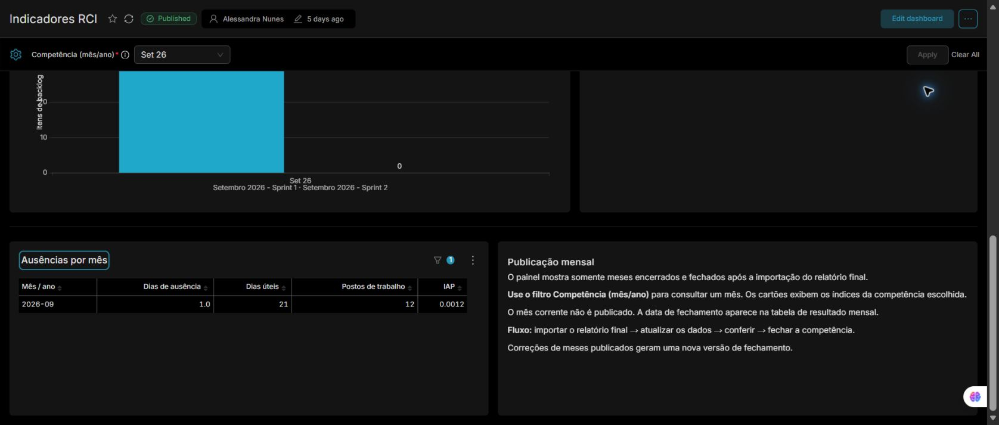

# Dashboard RCI · Embratur

Apuração mensal de entregas, falhas e ausências do projeto Salesforce, com PostgreSQL e Apache Superset. O painel consolida as sprints pelo mês do término previsto e publica competências após conferência e fechamento explícito.



## O projeto

O modelo reúne histórias e sprints do Taiga, normaliza os registros de ausência, calcula os dias úteis e mantém versões dos indicadores aprovados. O RCI exibido no card e na tabela é truncado em três casas decimais a partir de `rci_preciso`.



## Organização

```text
docs/
  arquitetura.md             Distribuição das fontes, fatos, dimensões e views
  dicionario-de-dados.md      Grão, chaves, campos e relacionamentos
  operacao.md                 Instalação, atualização e revisão mensal
  estado-do-painel.md         Configurações e limitações observadas
  imagens/                   Capturas do painel em 09/11/2026
sql/
  instalacao/                Definições dos objetos mensais
  operacao/                  Carga, conferência e exemplos de fechamento
superset/
  configuracao.md            Dataset, métricas, filtro e gráficos
  exportacao_20261109/        Configuração exportada com conexão parametrizada
```

## Indicadores

| Indicador | Cálculo |
|---|---|
| IES · entregas | `não entregues / itens planejados × 0,40` |
| IFB · falhas | `itens com falha / itens planejados × 0,30` |
| IAP · ausências | `dias de ausência / (postos × dias úteis) × 0,30` |
| RCI preciso | `1 − (IES + IFB + IAP)` |
| RCI no painel | `TRUNC(rci_preciso::numeric, 3)` |

A meta é `0,95`. Os componentes já incluem os pesos. O enquadramento da meta usa o valor preciso. A coluna histórica `rci` segue a regra anterior de arredondamento em duas casas, enquanto a apresentação atual usa `rci_preciso`.

## Modelo de dados

O schema `rci_embratur` contém as dimensões de calendário, feriados e sprints, as tabelas fato de histórias e eventos de ausência, os parâmetros por competência e o histórico versionado de fechamentos. Os relacionamentos analíticos são implementados nas views e na procedure.

Consulte o [diagrama e o fluxo dos dados](docs/arquitetura.md), o [dicionário das tabelas](docs/dicionario-de-dados.md) e o [passo a passo de operação](docs/operacao.md).

## Painel

Oito visualizações consultam `rci_embratur.vw_rci_meses_fechados_v2`, filtradas pelo projeto 3. O filtro mostra rótulos como `Set 26`. O gráfico de entregas inclui os nomes das sprints junto ao mês.



As capturas mostram setembro de 2026 após a revisão das ausências, com RCI `0,998`, 31 itens planejados, 31 entregues, 1 dia de ausência, 21 dias úteis e 12 postos. A conferência do painel e as pendências conhecidas estão em [estado do painel](docs/estado-do-painel.md).

## Execução

Os scripts de instalação adaptam uma base PostgreSQL com as fontes do Taiga e o calendário legado já existentes. Execute os blocos completos no SQL Lab conforme [operação](docs/operacao.md). Configure os parâmetros e confira o mês antes de executar o fechamento.

O pacote reúne código de estrutura e documentação, com capturas agregadas do dashboard. As planilhas de colaboradores e as cargas com registros individuais permanecem no ambiente operacional.

A [exportação do Superset](superset/exportacao_20261109) contém os oito gráficos, o dataset e o layout registrados em 09/11/2026. Para restaurar, configure a conexão PostgreSQL no ambiente de destino e siga as orientações de [configuração](superset/configuracao.md).

