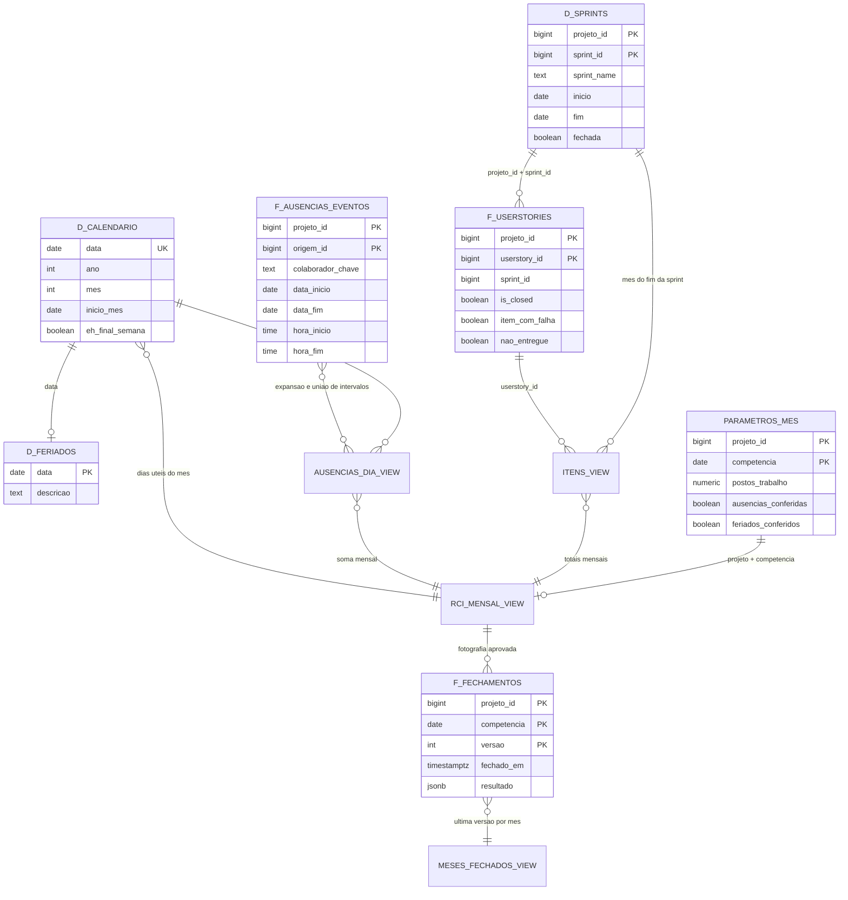
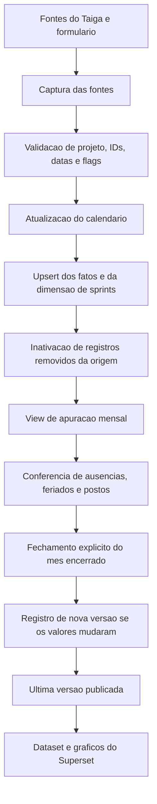

# Arquitetura e distribuição do banco

O modelo mensal combina fatos de histórias e eventos de ausência com dimensões temporais e sprints. A consolidação mensal ocorre em views. A tabela de fechamentos armazena os totais aprovados em JSONB por versão.

## Camadas

| Schema | Papel | Objetos utilizados |
|---|---|---|
| `public` | Fontes operacionais do Taiga | `milestones_milestone`, `userstories_userstory`, `custom_attributes_userstorycustomattributesvalues`, `custom_attributes_userstorycustomattribute` |
| `taiga_schema` | Entrada do formulário | `ausencias_raw` |
| `rci_embratur` | Modelo analítico mensal | Dimensões, fatos, parâmetros, views e procedimentos descritos abaixo |

O projeto Salesforce é identificado por `project_id = 3` na origem e `projeto_id = 3` no modelo. Os atributos customizados são validados por projeto, ID e nome antes da carga.

## Relacionamentos analíticos

O diagrama mostra as chaves de associação usadas nas consultas. Os DDLs mensais declaram chaves primárias e verificações, e a integridade das associações entre fatos e dimensões é validada pela carga. As linhas do diagrama representam relações lógicas.

Os nomes abreviados do diagrama correspondem aos nomes completos no [dicionário](dicionario-de-dados.md). `AUSENCIAS_DIA_VIEW`, `ITENS_VIEW`, `RCI_MENSAL_VIEW` e `MESES_FECHADOS_VIEW` representam views.

## Calendário

`d_calendario` contém uma linha por data. A procedure `sp_calendario_mensal_v2` preenche e atualiza seus atributos por upsert. A carga calcula a cobertura a partir das fontes e a estende, no mínimo, até o fim do segundo ano após o ano corrente.

`vw_calendario_diario_mensal_v2` combina o calendário com `d_feriados_mensal_v2` e calcula `eh_dia_util = NOT eh_final_semana AND feriado IS NULL`. A coluna `dia_semana_iso` usa segunda-feira igual a 1 e domingo igual a 7. O campo legado `dia_semana` usa domingo igual a 0.

Os feriados configurados correspondem à cidade do Rio de Janeiro, com cobertura de outubro de 2025 a dezembro de 2026. A lista e sua aplicação por competência precisam de manutenção quando a cobertura for ampliada.

## Fluxo de atualização e publicação

As rotinas de atualização e fechamento compartilham bloqueio transacional para evitar publicações concorrentes. A carga valida as fontes antes de publicar. Uma falha interrompe a operação. O controle registra a última carga concluída.

## Granularidade e histórico

Histórias pertencem ao mês do término previsto de suas sprints fechadas. Ausências pertencem às datas efetivas em que ocorreram, distribuídas pelo calendário. Elas se encontram apenas depois da agregação por projeto e mês, evitando multiplicar dias de ausência pelo número de histórias ou sprints.

`f_fechamentos_mensal_v2` preserva os resultados de cada versão. A view publicada seleciona a versão mais recente por projeto e competência e reconstrói as colunas a partir do JSONB. A inclusão dos nomes das sprints consulta a dimensão atual. Renomeações retroativas podem mudar esse texto complementar, enquanto os totais aprovados permanecem na fotografia de fechamento.
