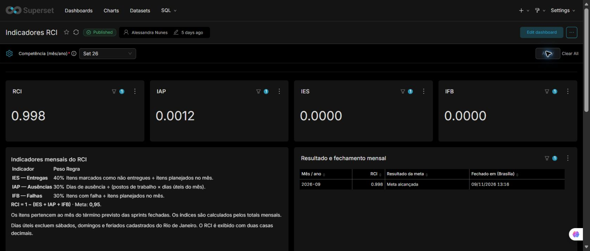
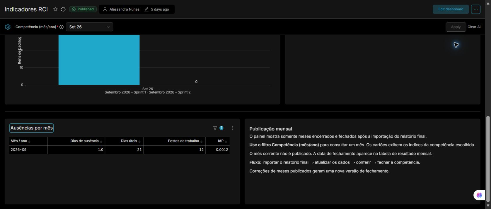
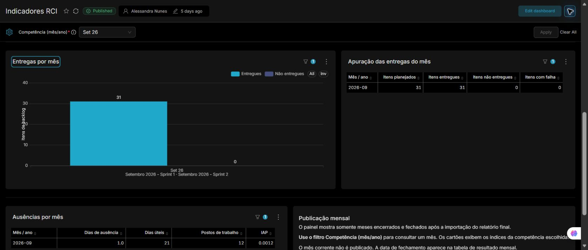

# Estado do painel e registro da documentação

Documentação organizada em 09/11/2026 a partir dos SQLs da migração, dos resultados conferidos no SQL Lab e das configurações salvas durante a manutenção do Superset.

## Resultado registrado

Os prints desta publicação foram capturados no painel com `Set 26` aplicado. O cartão e a tabela de resultado exibem `0.998`, o IAP mostra `0.0012` e a tabela de ausências contém 1 dia de ausência, 21 dias úteis e 12 postos. A revisão foi publicada em 09/11/2026. Agosto e setembro receberam a versão 2 após a inclusão das ausências.

## Pontos a acompanhar

- O filtro padrão está fixado em setembro de 2026. A escolha automática do mês publicado mais recente permanece pendente.
- Ao limpar a competência, os cartões podem apresentar `No data`, pois as métricas exigem um único mês. A captura foi feita após reaplicar setembro.
- A ordenação cronológica crescente do filtro ainda precisa ser conferida e finalizada no Superset.
- O texto explicativo do painel ainda cita duas casas decimais. O card e a tabela já exibem o RCI truncado em três casas. A documentação registra essa diferença.
- O texto de sprints é derivado da dimensão atual. Ele pode refletir renomeações posteriores ao fechamento.
- O calendário preenche datas futuras, mas a lista de feriados entregue cobre até dezembro de 2026.
- A publicação inclui a exportação de 09/11/2026, com URI de conexão substituída por parâmetros de exemplo e parâmetros extras esvaziados.

## Escopo da validação

Os SQLs 01, 02, 03 e o fechamento mensal foram exercitados anteriormente em ambiente PostgreSQL local com dados sintéticos. Na operação do Superset foram conferidos os carregamentos, as revisões de agosto e setembro e o truncamento exibido no painel. A preparação deste repositório verificou os arquivos, os links locais, as capturas e as expressões dos YAMLs exportados. A instalação completa em um banco vazio e a importação do dashboard em outro ambiente não foram executadas nesta publicação.
